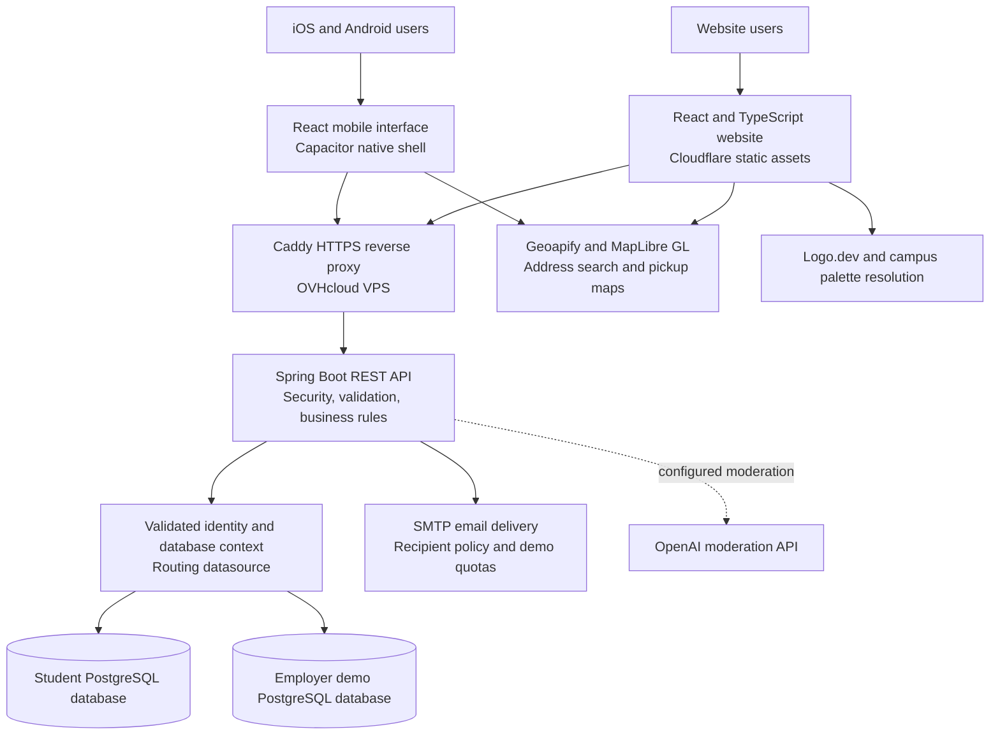
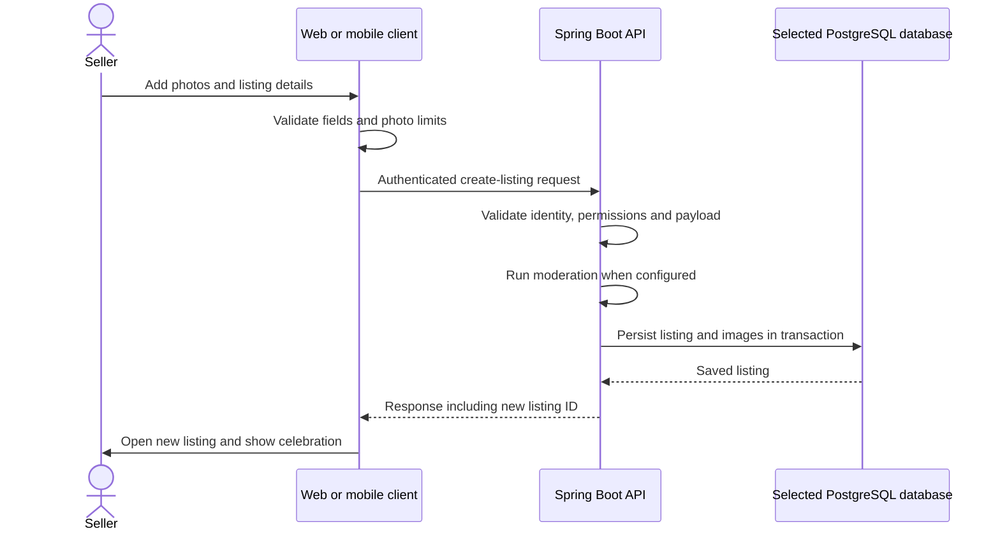

# Quaddl
### A campus marketplace built across web, iOS, and Android

**A full-stack project by Isaiah Maxwell**

[Explore Quaddl](https://quaddl.com) · [Request employer demo access](https://quaddl.com/contact) · [Architecture](#system-architecture) · [Mobile app](#mobile-app) · [Engineering decisions](#engineering-decisions-and-tradeoffs)

Quaddl is a marketplace where university students can buy, sell, and swap items with people on their campus. It brings listings, saved items, seller profiles, reviews, and messages into one website and mobile app.

The goal is simple: make it easier to find something nearby, learn about the seller, and arrange a pickup without jumping between different apps.

## My role and the tools I used

**I designed Quaddl’s architecture.** I chose how the website, mobile app, backend, databases, and outside services would work together, including keeping employer demo data separate from student data.

I used **ChatGPT and GitHub Copilot** to help with writing code, debugging errors, and working through implementation details. This was an AI-assisted build. The architecture and overall project direction were my own, and the sections below explain those decisions and what I would improve next.

> This repository is a walkthrough of the project. The application source is private. Only `README.md` is tracked here; screenshots and the GIF are stored as release attachments.

## A quick overview

- **What it does:** Students can list items, browse their campus marketplace, save things, and message sellers.
- **Website and app:** React and TypeScript, with Capacitor for the iOS and Android apps.
- **Backend:** Java and Spring Boot handle accounts, permissions, listings, messages, and email.
- **Hosting:** The website is on Cloudflare. The API and PostgreSQL run in Docker on an OVHcloud VPS, with Caddy handling HTTPS.
- **Portfolio demo:** Invited employers can try real account and email workflows using fictional marketplace data in a separate database.
- **Main challenges:** Keeping campus and demo data separate, handling failed requests, and making the app comfortable to use on a phone.

## Employer demo access

**Hiring managers and recruiters: [request an invitation through Quaddl’s contact form](https://quaddl.com/contact).** Choose **Other** as the topic and start your message with **Employer demo access**.

Please include your name, company or role, and the email address you would like approved. A work or personal email can be invited; an `.edu` address is not required for approved employer demo accounts. I add demo addresses manually, so please request access before signing up.

Once your address is approved, you can:

1. Create your own account and verify your email.
2. Browse clearly labeled fictional listings and save an item.
3. Publish, edit, and delete a sample listing.
4. Open seller profiles and try messaging.
5. Request a password reset and receive the email at your approved address.
6. Preview campus themes on the website and mobile app.

The demo has its own database, so you won’t be interacting with student accounts or listings. Emails go only to approved addresses, with limits on how often they can be sent. You use your own account and email address. The **18+ confirmation** and terms still apply.

**Suggested review path:** browse → open a listing → save it → publish a sample item → edit it → try a password-reset email. The site displays **“Portfolio demo — sample listings.”** No real purchases are involved.

## Product preview

These screenshots use sample accounts and listings from development.

### Website: seller profiles and campus colors

### Mobile: browsing and campus themes

  
  &nbsp;&nbsp;
  

<strong>Animated mobile interface gallery</strong>

This GIF cycles through screenshots of the marketplace, campus themes, and settings. I’ll replace it with a screen recording of the full flow later.

  

<!-- MEDIA TEMPLATE: Replace the release URLs above with updated screenshots whenever the UI changes.
Optional screen-recording slot, after recording a real end-to-end flow:

Suggested recording: choose photos -> reorder cover -> complete six steps -> publish -> new listing and confetti.
Do not publish real email addresses, reset codes, verification links, tokens, or private conversations in media.
-->

## Why build a campus marketplace?

| Problem | How Quaddl handles it |
| --- | --- |
| Campus items are scattered across chat threads and broad local feeds. | Students browse listings from their university and can search or filter by category and condition. |
| Buyers need context before contacting a seller. | Profiles show the seller’s campus, ratings, reviews, and active or sold listings. |
| Selling from a phone can become a long, error-prone form. | The mobile form breaks creating and editing a listing into six smaller steps. |
| Users need ways to control unwanted interactions. | Users can block accounts and report listings or profiles. The backend checks who is allowed to make changes. |
| Campus identity is often missing from generic marketplaces. | Campus colors give each marketplace its own look, with a default theme and light/dark options. |

### What makes Quaddl different?

Other campus marketplaces may offer similar features. What I focused on with Quaddl is how these pieces work together:

| Design choice | Why it matters |
| --- | --- |
| The backend checks campus membership when loading listings. | The campus boundary is enforced by the API, so changing a filter in the browser does not grant access to another campus. |
| Listings, profiles, reviews, and messages use the same account. | A buyer can look at an item, check the seller, and start a conversation in one place. |
| The mobile interface is built for a phone and uses the same API as the website. | The app gets stepped forms, gestures, and a native photo picker while the backend keeps the rules consistent. |
| The employer demo uses a separate database and approved email recipients. | Employers can try account creation and real emails without a university address or access to student data. |
| Theme changes only affect appearance. | An employer can preview different campus colors without changing their account’s access. |

## What users can do

| Area | Features |
| --- | --- |
| Accounts | Registration, email verification, email/password login, password recovery, profile editing, required 18+ and terms confirmation, and account deletion. Google sign-in integrations are also present; platform status is noted below. |
| Marketplace | Browse and search; category, condition, and sort controls; listing detail pages; create/edit/delete; active/sold status; pickup address suggestions and maps. |
| Listing media | Up to five photos, cover-photo ordering, touch reordering, native multi-photo selection, and swipeable mobile product images. |
| Engagement | Saved listings, share controls, seller profiles, ratings/reviews, buyer–seller conversations, unread indicators, and notification email workflows. |
| Safety and support | Block users, report listings/profiles, contact support, validate submissions, enforce ownership, and apply configured moderation checks. |
| Personalization | Default/campus appearance options, light/dark/system appearance, and employer previews for UNC Charlotte, ECU, NC State, UNC, Virginia Tech, and Duke. |

**A couple of limits:** Quaddl lets sellers list accepted payment methods, but payments happen outside the app. It does not offer checkout or escrow. Users confirm that they are 18 or older; there is no ID verification system.

## Mobile app

I used **Capacitor** to package a separate React interface for iOS and Android. The UI runs in a native WebView, and plugins connect it to phone features like the photo library, keyboard, and share menu.

Some of the mobile features are:

- A photo-focused two-column feed and floating bottom navigation with a prominent Sell action.
- Six-step listing creation **and editing**: photos → title/description → category/condition → price/payment methods → pickup → review/publish.
- Native library selection limited to the remaining photo slots, draggable ordering, and a clear first-photo cover position.
- Swipeable product images, native sharing, and successful-publish navigation with a brief confetti celebration.
- A settings sidebar with entry/exit animation, plus bottom sheets for focused actions such as filters, reviews, and confirmations.
- A stepped registration flow, safe-area spacing, keyboard handling, and Android back navigation.
- Contrast-aware light/dark campus colors, reduced-motion handling, and portrait-only configuration where supported by the operating system.

### Store release status

**Quaddl still needs to be uploaded to the Apple App Store and Google Play Store.** There are development builds for iOS and Android. I’m currently waiting on **LLC formation** before setting up the organization developer accounts and submitting the app.

The LLC is part of my release plan. Once the app is approved, I’ll add the store links here.

Google sign-in is configured for the website and iOS. Android Google sign-in and release signing still need to be finished and tested. The push-notification plugin is installed, but push delivery is not finished yet.

## System architecture

Both the website and mobile app use the same API. Student accounts and employer demo accounts use separate PostgreSQL databases.

After checking a signed token, the backend selects the correct database before looking up the user or handling the request. It also checks that an employer’s email is still on the invitation list. The database setup rejects a demo configuration that points to the same database or database user as production.

The backend follows a controller → service → repository structure. Controllers handle requests, services apply the rules, and repositories read and write data. Response DTOs control what each client receives.

**Main data relationships:** A profile owns listings. Each listing has photos and can have conversations, which contain messages. Saved items connect users to listings, and reviews connect a reviewer to a seller. Blocks and reports are stored separately. For now, image files are stored in PostgreSQL too.

### Example: publishing a listing

The app opens the new listing and shows confetti after the server confirms it was saved. If something fails, the user stays in the form and can fix the problem.

## Engineering decisions and tradeoffs

### 1. Checking permissions in the backend

Hiding an Edit or Delete button does not stop someone from sending an API request. The backend checks the signed-in user, ownership, and campus or demo access before allowing those actions. Blocking also affects which listings people see and who they can interact with.

Accounts use JWTs, BCrypt password hashing, email verification, and the required eligibility confirmation.

### 2. Giving employers a demo that actually works

I wanted employers to be able to post an item and receive a verification or reset email without using student data. I designed the demo around a separate database and an approved email list.

That takes more setup than putting everyone in the same database. It also means the backend has to keep the right database context throughout a request. The benefit is that employers can try the product with their own email address while student data stays separate. Email limits help prevent people from using the demo to send unwanted mail.

### 3. Handling email failures after a message is saved

A conversation message is saved before its notification email is sent. If email delivery fails, the saved message should still be available.

The current code sends the notification after the database transaction commits. That handles part of the problem, but it does not guarantee delivery. I would add a persistent queue or outbox with retries next.

### 4. Keeping web and mobile consistent

The website and mobile app use the same API, but their UI code is separate. That gave me room to change the mobile navigation, forms, and gestures without forcing the desktop layout onto a phone.

The downside is duplicated types, validation, and theme code. I would move those pieces into a shared package to make updates easier to keep in sync.

### 5. Keeping deployment manageable

I chose one Spring Boot backend with separate feature areas, deployed through Docker Compose. I did not need multiple services just to split accounts, listings, and messages apart.

Storing photos in PostgreSQL also kept the first version simpler. As the app grows, object storage and smaller database queries would be more useful than adding infrastructure without knowing what is slow.

## Technology stack

| Layer | Technologies and purpose |
| --- | --- |
| Web interface | **React 19, TypeScript, Vite, Tailwind CSS 4**; **React Router** for navigation; **TanStack Query** for server-state caching/refetching; **Axios** for API requests. |
| Mobile platform | **Capacitor 8**, React/TypeScript, native WebViews; **Swift/UIKit, Xcode, Swift Package Manager** on iOS; **Java, Android SDK, Android Studio, Gradle** on Android. Native plugins cover app lifecycle/back handling, camera/photo library, keyboard, sharing, splash screen, and status bar. |
| Backend | **Java 25, Spring Boot 4, Spring Web MVC, Spring Security**, Bean Validation/Jakarta Validation, REST controllers and DTOs, **Lombok**, **Maven/Maven Wrapper**. |
| Identity | **JWT/JJWT**, **BCrypt**, Google **OAuth 2.0/OpenID Connect**, email verification and password-reset workflows. Authorization is enforced by the API. |
| Persistence | **PostgreSQL**, **Spring Data JPA/Hibernate**, JDBC, **HikariCP**, transactions, separate routing datasources for student and employer data. |
| Maps and visual identity | **Geoapify** autocomplete/maps, **MapLibre GL**, **Logo.dev**, **color-thief-react** palette extraction, published campus color presets, **DM Sans** and **Montserrat Alternates**, CSS/SVG interface icons. |
| Email, moderation, support | **Spring Mail/JavaMail and SMTP**, branded emails, after-commit notification listeners, demo sending budgets; **OpenAI moderation API** when configured. **FreeScout** is deployed alongside the service stack for helpdesk operations. |
| Infrastructure and delivery | **OVHcloud VPS/Ubuntu**, **Docker and Docker Compose**, **Caddy** reverse proxy/TLS, **Cloudflare Workers static assets/CDN and DNS**, **Wrangler**, **Git and GitHub**, npm and dependency lockfiles. **ChatGPT and GitHub Copilot** assisted development and debugging. |
| Testing and tooling | **JUnit/Jupiter, Mockito, Spring Boot Test, Spring Security Test, H2** for backend tests; **Node.js built-in test runner** for TypeScript-related checks; TypeScript type checking, **Oxlint**, production builds, and native development builds. |

Libraries that are installed but not fully in use

**TensorFlow.js** and **NSFWJS** are in the project dependencies, but there is no active client-side ML moderation flow shown here. The backend has an optional OpenAI moderation integration.

The Capacitor **Haptics** and **Push Notifications** packages are also installed. Push delivery is still a release task. I’ve kept these separate from the finished features so the list reflects what actually works, not just what is in a package file.

## How I check the app

Testing covers the normal user flows and cases where the app needs to reject a request:

- Authentication failures, CORS responses, eligibility and terms enforcement, and password-reset behavior.
- Employer database routing, demo isolation, approved mail recipients, and sending budgets.
- Ownership/deletion rules, blocked-user visibility, reports, and sold-listing messaging behavior.
- Campus theme restrictions and persistence, mobile form validation, photo reordering, touch-capture cancellation, and swipe direction handling.
- Website/mobile type checks and builds, native development builds, and browser checks using fictional data.

These checks have been run during development. I still need to add automated CI, load testing, and more physical-device testing before treating this as a finished release.

## What I would improve next

| Priority | What I would change | Why |
| --- | --- | --- |
| 1 | Move images to S3-compatible object storage with upload validation and thumbnail generation. | Keep large image files out of the database and load smaller previews in the feed. |
| 2 | Add an outbox/job queue with bounded retries and idempotent notification handling. | Retry failed emails without losing notifications or sending the same one twice. |
| 3 | Move filtering, sorting, and pagination fully into indexed database queries; measure query plans. | Fetch only the listings needed for a page instead of loading a growing collection into memory. |
| 4 | Add structured metrics, request tracing, error reporting, and tested backup restoration. | Find slow requests and failures, and check that a backup can actually be restored. |
| 5 | Automate CI checks, migration verification, staging smoke tests, and deploy rollback checks. | Catch problems before deploying and make it easier to recover from a bad release. |
| 6 | Extract shared contracts and validation; review native token storage and session renewal. | Keep both clients consistent and improve how the app stores and renews sessions. |
| 7 | Evaluate WebSocket/SSE messaging and complete push delivery. | Messages currently refresh through polling. WebSocket/SSE and push could make updates arrive sooner with fewer repeated requests. |
| 8 | Complete LLC formation, organization developer-account setup, and store submission; expand device/accessibility testing. | Prepare App Store and Google Play releases, validate Android Google sign-in and signing, and test keyboard/safe-area behavior, screen readers, large text, and OS-specific restrictions on physical devices. |

I would measure page load times, database queries, email failures, and image sizes before making bigger architecture changes. That would help me decide what actually needs work.

---

**Isaiah Maxwell** · Architecture and project direction, with development assistance from ChatGPT and GitHub Copilot.

Want to try it or talk through how it works? [Request employer demo access](https://quaddl.com/contact).
