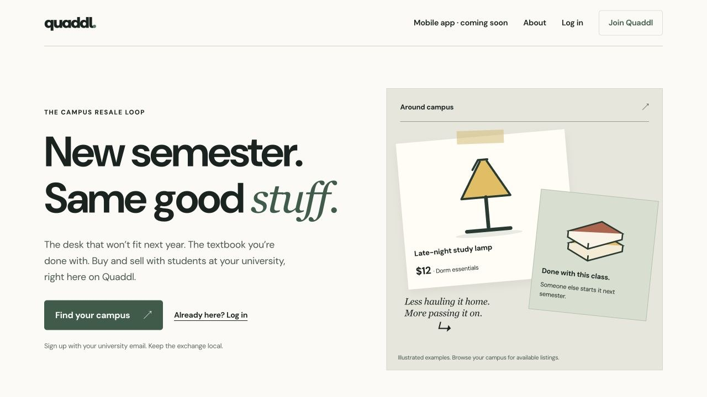
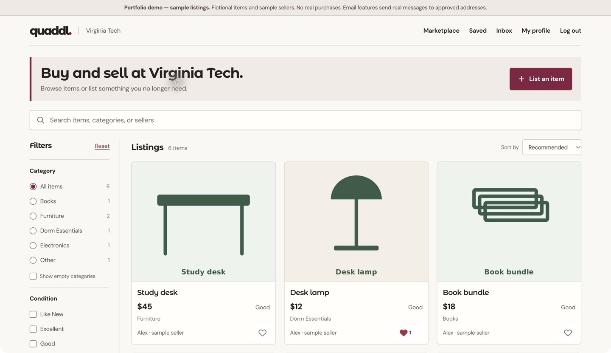
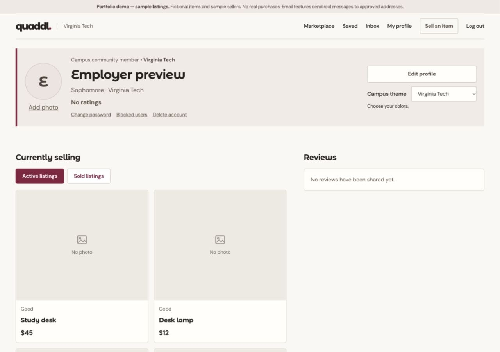
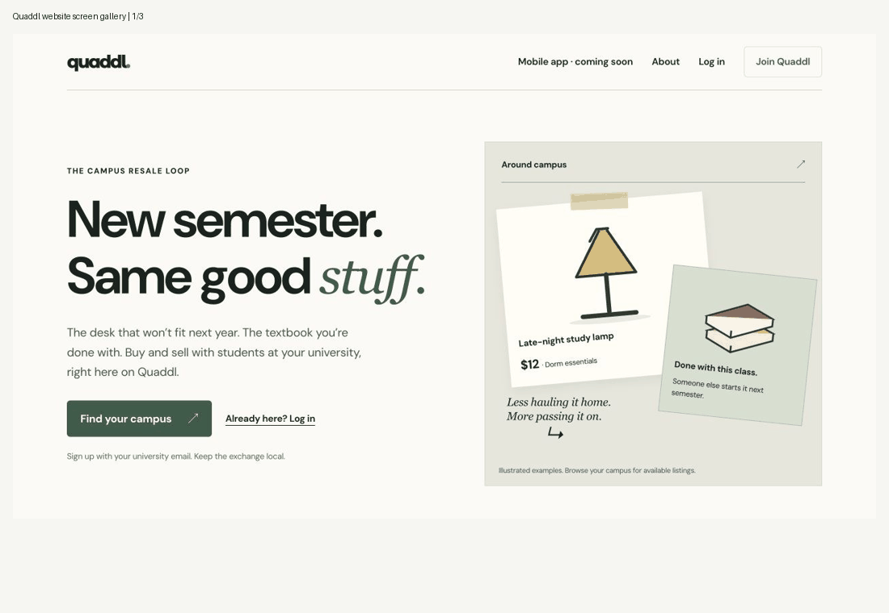
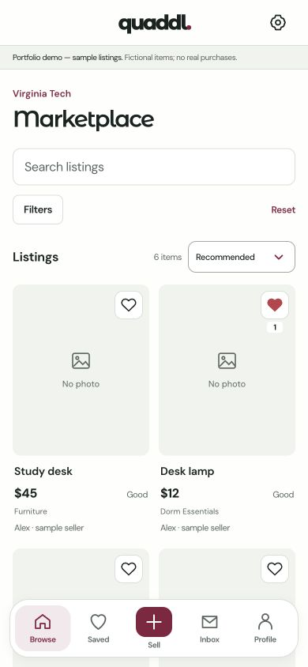
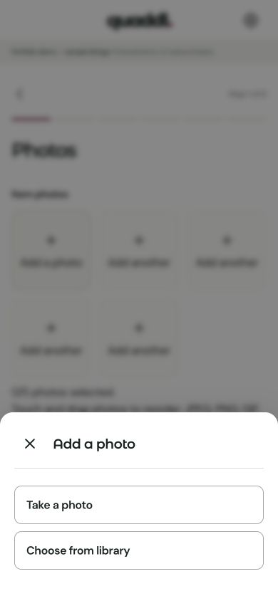
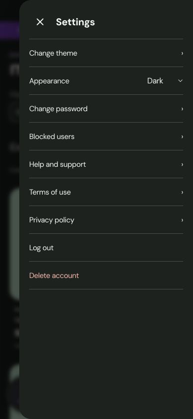
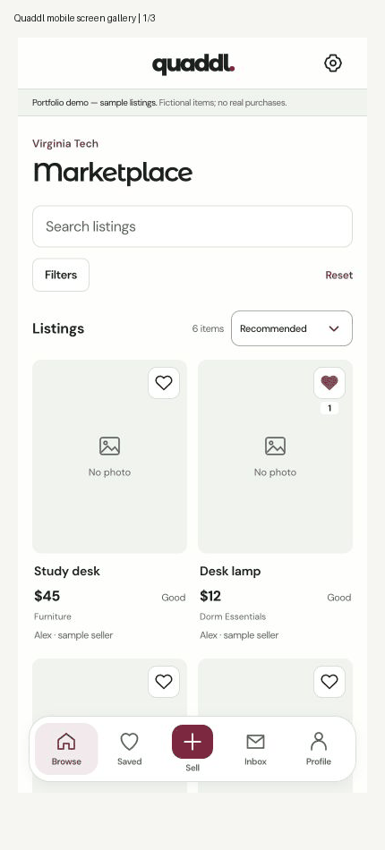
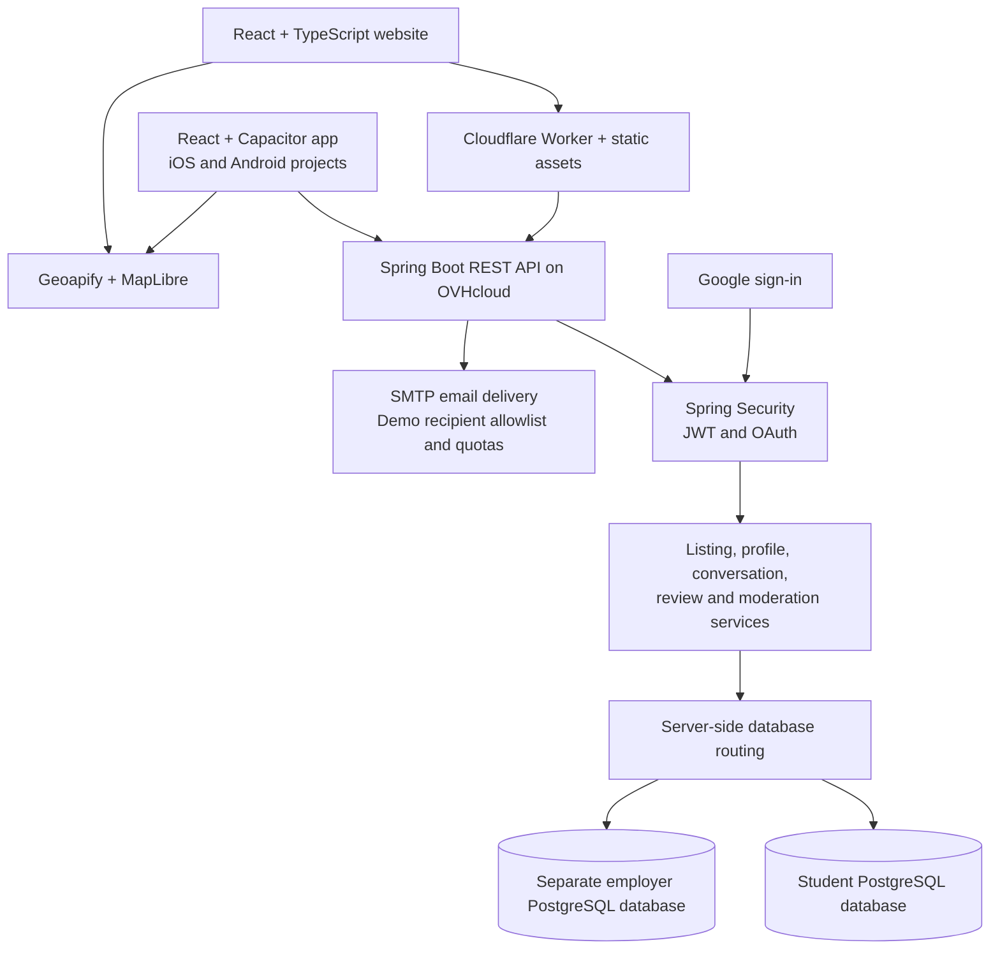
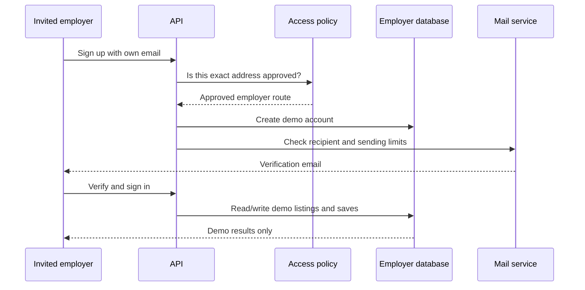

# Quaddl
### A campus marketplace I’m building as a college student

[Website](https://quaddl.com) · [Request an employer demo](https://quaddl.com/contact) · [Mobile app](#mobile-app)

I’m Isaiah Maxwell, a computer science student at UNC Charlotte. I built Quaddl around a pretty familiar problem: students need to get rid of things at the end of a semester, and other students need those same things a few months later. Finding an item, checking who is selling it, and arranging a pickup can end up spread across group chats and general marketplace apps.

Quaddl puts listings, saved items, seller profiles, reviews, and conversations in one place, organized around a university community. I designed the architecture and worked across the React website, Spring Boot API, PostgreSQL databases, deployment, and Capacitor mobile app.

This repository is a walkthrough of the project, not the application source. The source repositories are private. I wanted employers to be able to understand the build without having to dig through every file.

> **Current status:** Quaddl is a prelaunch project with an invitation-only employer demo. Student access is being held back while I work through launch requirements. The mobile app has iOS and Android projects but is not published on the App Store or Google Play. Screens below use fictional demo data and include development previews; they are not evidence of a public student launch.

## A quick look



### Website



The marketplace keeps search and filters close to the listings. I reduced the original oversized header so visitors can actually see items without scrolling through a landing page first. These captures show an earlier demo inventory with illustrated sample images or neutral placeholders.



**Website screen gallery:**



### Mobile app

The app shares the website’s fonts and campus colors, but I didn’t want it to feel like the desktop site squeezed into a phone.

<p>
  
  
  
</p>



*The GIFs cycle through real screenshots. They are screen galleries, not recordings of live gestures. Some screens were captured at different points during development, so small styling details vary.*

## What users can do

| Area | What I built |
| --- | --- |
| Accounts | Email verification, email/password login, Google sign-in integration, password reset, and an 18+ confirmation |
| Listings | Create, edit, delete, mark sold or active, upload photos, choose a cover image, and reorder photos |
| Discovery | Search, category and condition filters, price ranges, and sorting |
| Saved items | Save and unsave listings, then find them again on a dedicated page |
| Conversations | Contact a seller, read replies, see unread indicators, and delete a conversation |
| Profiles | Profile photos, class standing, seller listings, and reviews |
| Safety tools | Block users, report listings or profiles, and administrative moderation tools |
| Pickup | Geoapify location search and map previews with zoom controls |
| Appearance | Campus themes, a default theme, and light/dark mobile appearances |
| Sharing | Share a listing from its product page |

An email address being verified is not the same thing as proving someone’s identity or guaranteeing a safe transaction. Quaddl also reminds sellers to check their campus’s policies before posting.

## What makes it different?

I’m not claiming Quaddl invented student marketplaces. Other apps already cover parts of this idea. My focus is on keeping the whole exchange connected to the campus context:

- **A university-centered account model.** The intended student flow uses university email domains instead of starting with a broad citywide feed.
- **The conversation stays with the item.** Listings, seller profiles, saves, and messages are part of the same product instead of separate group-chat threads.
- **A mobile interface built around the task.** Listing creation is split into steps; photos can come from the camera or library; filters and confirmations use drawers where that makes sense.
- **An employer demo that can actually be used.** An invited employer can use their own approved email, verify it, post a test listing, save an item, and reset their password without entering the student database.

Those are product choices, not proof that Quaddl is better than every alternative. I still need feedback from real students to see which parts are useful and which parts need simplifying.

## How it fits together



The frontend handles screens, forms, and cached server data. The API handles account permissions, validation, and database operations. I use a controller/service/repository structure so HTTP handling, business logic, and persistence don’t all end up in the same class.

### Source structure

These paths describe the private application repository:

```text
Quaddl/
├── frontend/frontend/
│   ├── src/pages/           Website screens
│   ├── src/components/      Shared interface pieces
│   ├── src/entry-server.tsx Public-page rendering
│   ├── scripts/            Build-time prerendering
│   └── worker/             Cloudflare request handling
├── mobile/
│   ├── src/pages/          Mobile screens
│   ├── src/mobile/         Native integrations and mobile behavior
│   ├── ios/                Xcode project
│   └── android/            Android project
├── backend/
│   └── src/main/java/.../
│       ├── security/       Authentication and access checks
│       ├── demo/           Employer database routing and email limits
│       ├── listing/        Listings and listing status
│       ├── profile/        Accounts and profiles
│       ├── conversation/   Buyer/seller messages
│       ├── savedlisting/   Saved items
│       ├── review/         Reviews
│       ├── image/          Uploaded images
│       └── report/         Listing and profile reports
└── docs/                   Deployment notes
```

### Employer demo isolation



The employer demo uses the same application, with a separate database selected on the server. Changing a campus theme changes the appearance; it does not grant access to that university’s student data. Demo emails are limited to approved recipients and have resend/sending limits. The UI labels the inventory **“Portfolio demo — sample listings.”**

## Tech stack

| Part | Technologies and purpose |
| --- | --- |
| Website | React, TypeScript, Vite, React Router, Tailwind CSS, and custom CSS |
| Server state | TanStack Query for requests/cache behavior and Axios for HTTP |
| Mobile | Capacitor, iOS/Xcode, Android/Gradle, native camera/library, sharing, keyboard, splash screen, and status-bar integrations |
| API | Java, Spring Boot, Spring Web MVC, Spring Security, Bean Validation, and Lombok |
| Authentication | JWT with JJWT, password hashing, Google OAuth 2.0, email verification, and revocable persistent mobile sessions |
| Persistence | PostgreSQL, Spring Data JPA, and Hibernate |
| Location | Geoapify and MapLibre GL |
| Email | Spring Mail and SMTP, branded messages, recipient restrictions, and sending limits |
| Hosting | Cloudflare Workers/static assets for the website; OVHcloud VPS, Docker Compose, and Caddy for the backend |
| Search previews | Build-time rendering for public pages, route metadata, Open Graph/Twitter tags, sitemap, and robots controls |
| Validation/testing | JUnit, Mockito, Spring security/web tests, Node’s test runner, TypeScript checks, and manual responsive UI checks |
| Development | Git/GitHub, Maven, npm, Xcode, Android tooling, ChatGPT, and GitHub Copilot |
| Additional dependencies | TensorFlow.js/NSFWJS image moderation support and image color tooling; installed native push/haptics plugins do not mean every associated feature is ready for release |
| Typography | Montserrat Alternates and DM Sans |

## Problems I had to work through

### “It works locally” wasn’t enough

I ran into CORS failures, provider origin restrictions, and differences between browser and native app requests. Those problems made me look at the full request path instead of assuming the React page was the problem. I learned to separate an API failure from an authentication failure or a third-party service rejecting an origin.

### A demo needs boundaries

I wanted employers to try real verification and reset emails. Letting any visitor send unlimited email would have been a bad way to do that. The separate employer database, exact-address approval, and email limits came from working through that problem.

### Mobile needed more than smaller CSS

I had to account for safe areas, camera access, photo ordering, keyboard behavior, long names, and contrast in dark mode. I also changed long forms into steps and worked on drawer and navigation behavior. A browser preview helps, but it doesn’t replace testing on an actual phone.

### Search engines don’t use the app like a person does

The original client-rendered site didn’t give link previewers much useful HTML. I added build-time rendering for public pages and metadata handling while keeping private screens out of public snapshots. I didn’t need to rewrite the whole app to improve that part.

### Backups are part of the project

After losing a local mobile folder, I reconstructed the app using surviving code and previous work. That was a frustrating way to learn why frequent commits, off-device backups, and separate database backups matter. I now treat recovery and deployment notes as part of building the app.

## What I learned

The biggest change for me was going from building individual features to thinking about how they interact. Saving a listing affects cached data on multiple screens. Deleting an account affects related records. A theme change should not change data access. A successful build doesn’t mean email delivery or camera permissions work on a real device.

I got more comfortable with Java/Spring, relational data, authentication, frontend state, and deployment. I also learned that a smaller, clearer interface often takes more revision than a page full of cards and effects.

### How I used AI tools

I used ChatGPT and GitHub Copilot to help with implementation, debugging, and exploring approaches. I designed the architecture and made the product decisions. This was an AI-assisted project, and I don’t want to present it as though I typed every line without help. Being able to explain a change, check its behavior, and take responsibility for the result matters more to me than hiding the tools I used.

## What I’d improve next

- **Finish launch preparation.** Work through the business and policy requirements, then complete store signing, submissions, and device testing. I’m planning an LLC as part of my own launch process; it isn’t a technical dependency of the app.
- **Test the critical flows end to end.** Add repeatable browser/device coverage for account recovery, posting/editing, messaging, and employer/student isolation.
- **Make releases less manual.** Add CI checks, more repeatable deployments, health monitoring, and a documented rollback process.
- **Improve media storage.** Move uploads toward object storage and a CDN, with predictable resizing and cleanup as usage grows.
- **Clean up shared code.** The web and mobile interfaces have overlap. I’d extract shared types and API logic without forcing both interfaces to look the same.
- **Get real usability feedback.** Watch students try the product before adding more features. I don’t have usage numbers to claim product-market fit yet.
- **Review security and accessibility more thoroughly.** Include keyboard/screen-reader checks, automated contrast checks, dependency review, and more negative authorization tests.
- **Improve database change management.** Make schema changes and backup/restore checks more repeatable as the project gets larger.

## Try the employer demo

Use the [Quaddl contact page](https://quaddl.com/contact) to request access. Choose an appropriate topic and include the email you want approved, your name, and that you’re reviewing my portfolio. Please don’t send a password.

Once approved, you can use your own email to try verification, sign-in, listing creation, saves, and password reset. Listings and sellers in the demo are fictional; there are no real purchases. Verification and reset emails are real. Please use test content rather than private or sensitive information.

**Suggested five-minute walkthrough:** sign in → browse/filter → save an item → create and edit a test listing → look at the profile and mobile screenshots.

## About this repository

This public repository contains documentation and selected screenshots/GIFs only. It does not contain the private application source, database exports, account credentials, signing keys, or environment files. Screens are a record of development, not a promise that every integration is available on every device today.
