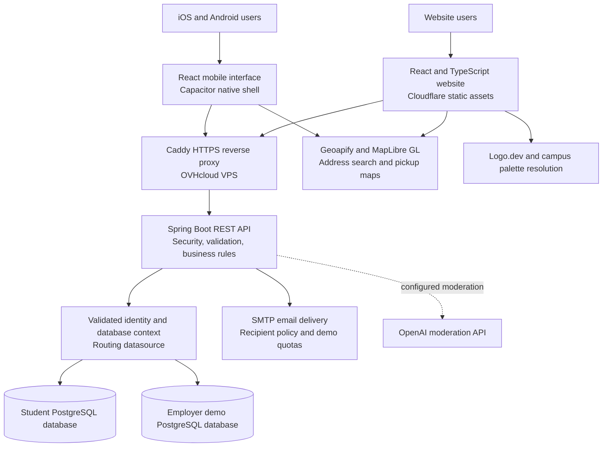
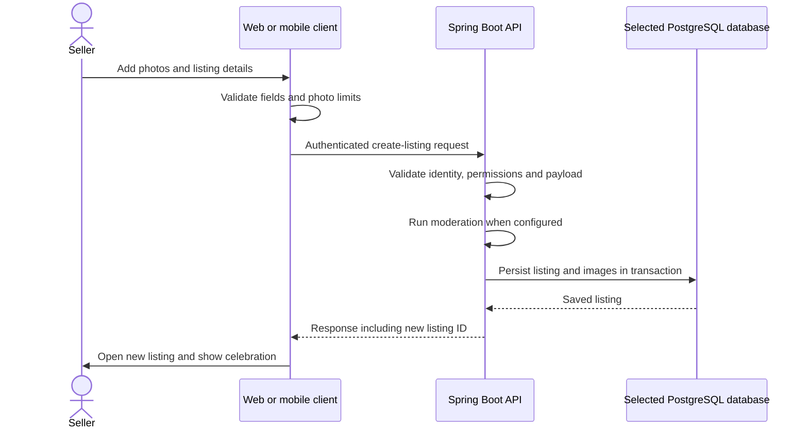

# Quaddl
### A campus marketplace built across web, iOS, and Android

**Full-stack engineering showcase · Isaiah Maxwell**

[Explore Quaddl](https://quaddl.com) · [Request employer demo access](https://quaddl.com/contact) · [Architecture](#system-architecture) · [Mobile app](#mobile-app) · [Engineering decisions](#engineering-decisions-and-tradeoffs)

Quaddl helps university students buy, sell, and swap items within their campus community. It combines campus-scoped discovery, seller profiles, conversations, saved listings, and account email workflows in a responsive website and a dedicated mobile app.

I built the product across the interface, API, relational data model, native integrations, and deployment stack. The engineering challenge extends beyond displaying listings: each action needs the right identity, campus, permissions, and database context, while the experience should remain straightforward on a phone.

> **About this repository:** This is a public product and architecture case study. Application source code is private. Only `README.md` is tracked here; screenshots and the GIF are hosted as release attachments.

## The project in 60 seconds

- **Product:** A university marketplace with listings, buyer–seller conversations, profiles, reviews, and campus identity.
- **Clients:** React/TypeScript website plus a separate React/Capacitor mobile interface packaged for iOS and Android.
- **Backend:** A Java/Spring Boot REST API with authentication, authorization, validation, database access, and email workflows.
- **Deployment:** Cloudflare-hosted website; containerized API and PostgreSQL on an OVHcloud VPS behind Caddy.
- **Portfolio demo:** Invited employers can try real account and email workflows using fictional marketplace data in a separate database.
- **Engineering focus:** Access boundaries, safe demo design, transactional behavior, native interactions, and deployment without exposing student data.

## Employer demo access

**Hiring managers and recruiters: [request an invitation through Quaddl’s contact form](https://quaddl.com/contact).** Choose **Other** as the topic and start your message with **Employer demo access**.

Please include your name, company or role, and the email address you would like approved. A work or personal email can be invited; an `.edu` address is not required for approved employer demo accounts. Approval is handled manually, so please request access before attempting demo registration.

Once your address is approved, you can:

1. Create your own account and verify your email.
2. Browse clearly labeled fictional listings and save an item.
3. Publish, edit, and delete a sample listing.
4. Explore seller profiles and the conversation experience.
5. Request a password reset and receive the email at your approved address.
6. Preview campus themes on the website and mobile app.

The demo uses a separate database from the student marketplace. Real demo emails are restricted to approved recipients and subject to sending limits. Users must confirm they are **18 or older** and accept the terms. No shared mailbox or shared account password is needed.

**Suggested review path:** browse → open a listing → save it → publish a sample item → edit it → try a password-reset email. The site displays **“Portfolio demo — sample listings.”** No real purchases are involved.

## Product preview

The captures below use fictional development data. They show the implemented interface; they are not evidence of live users, completed purchases, or marketplace traction.

### Website: campus identity and seller profiles

### Mobile: browsing and campus themes

  
  &nbsp;&nbsp;
  

<strong>Animated mobile interface gallery</strong>

This GIF rotates actual screenshots of browsing, campus themes, and settings. It is an animated gallery, not a recording of taps or transition timing.

  

<!-- MEDIA TEMPLATE: Replace the release URLs above with updated screenshots whenever the UI changes.
Optional screen-recording slot, after recording a real end-to-end flow:

Suggested recording: choose photos -> reorder cover -> complete six steps -> publish -> new listing and confetti.
Do not publish real email addresses, reset codes, verification links, tokens, or private conversations in media.
-->

## The problems Quaddl addresses

| Student problem | Product response |
| --- | --- |
| Campus items are scattered across chat threads and broad local feeds. | A structured marketplace scoped to the student’s university, with searchable listings and category/condition filters. |
| Buyers need context before contacting a seller. | Listing details, campus affiliation, seller profiles, ratings, reviews, and active/sold listing history. |
| Selling from a phone can become a long, error-prone form. | Guided mobile listing creation and editing with photos, descriptions, condition, price, payment preferences, and pickup details. |
| Users need ways to control unwanted interactions. | Blocking, listing/profile reporting, ownership checks, and content validation. |
| Campus identity is often missing from generic marketplaces. | University-specific visual themes, with a default appearance option and light/dark support. |

### How the approach differs

These are Quaddl’s design choices, rather than claims that no competing app offers similar features.

| Design choice | Why it matters |
| --- | --- |
| Campus membership influences server-side listing access. | Campus relevance is part of the data-access model, rather than only a visual filter. |
| Listing discovery, profiles, reviews, and conversations share one account system. | Users can move from evaluating an item to contacting its seller without switching to another service. |
| A separate mobile interface uses the same backend contract as the website. | Mobile can have guided forms, touch gestures, and native photo selection while preserving consistent business rules. |
| An invited employer demo has its own database and controlled email delivery. | Recruiters can evaluate the full product without needing a university email or interacting with student data. |
| Campus theme changes are appearance preferences. | Previewing Virginia Tech or Duke does not change a user’s permissions, campus membership, or database routing. |

## What users can do

| Area | Implemented capabilities |
| --- | --- |
| Accounts | Registration, email verification, email/password login, password recovery, profile editing, required 18+ and terms confirmation, and account deletion. Google sign-in integrations are also present; platform status is noted below. |
| Marketplace | Browse and search; category, condition, and sort controls; listing detail pages; create/edit/delete; active/sold status; pickup address suggestions and maps. |
| Listing media | Up to five photos, cover-photo ordering, touch reordering, native multi-photo selection, and swipeable mobile product images. |
| Engagement | Saved listings, share controls, seller profiles, ratings/reviews, buyer–seller conversations, unread indicators, and notification email workflows. |
| Safety and support | Block users, report listings/profiles, contact support, validate submissions, enforce ownership, and apply configured moderation checks. |
| Personalization | Default/campus appearance options, light/dark/system appearance, and employer previews for UNC Charlotte, ECU, NC State, UNC, Virginia Tech, and Duke. |

**Scope:** Payment methods are preferences for arranging a transaction. Quaddl does not currently process payments, hold escrow, verify delivery, or guarantee a transaction. The 18+ requirement is a user confirmation, not identity-document verification.

## Mobile app

The mobile app has its own React interface and native iOS/Android projects through **Capacitor**. It is a hybrid application rendered in a native WebView, with native capabilities exposed through plugins; it is not a React Native implementation.

Mobile-specific work includes:

- A photo-focused two-column feed and floating bottom navigation with a prominent Sell action.
- Six-step listing creation **and editing**: photos → title/description → category/condition → price/payment methods → pickup → review/publish.
- Native library selection limited to the remaining photo slots, draggable ordering, and a clear first-photo cover position.
- Swipeable product images, native sharing, and successful-publish navigation with a brief confetti celebration.
- A settings sidebar with entry/exit animation, plus bottom sheets for focused actions such as filters, reviews, and confirmations.
- A stepped registration flow, safe-area spacing, keyboard handling, and Android back navigation.
- Contrast-aware light/dark campus colors, reduced-motion handling, and portrait-only configuration where supported by the operating system.

**Distribution status:** Native development builds exist for iOS and Android; this showcase does not claim an App Store or Google Play release. Google sign-in was configured for web and iOS; Android OAuth configuration and release-signing validation remain release tasks. Push-notification support is represented by an installed native plugin, not a claim of verified end-to-end push delivery.

## System architecture

**One API deployment, separate data contexts.** Authentication establishes the applicable database context; authenticated requests carry a signed database claim. Routing runs before user lookup and application handlers, so identity resolution and subsequent operations use the same context. Employer invitations are checked server-side. The employer datasource configuration rejects using the same database or database user as production.

Inside the API, controllers accept validated requests, services apply business rules and authorization, repositories manage persistence, and response DTOs expose the fields needed by each client. Feature areas include accounts, schools, listings, images, saved items, conversations/messages, reviews, reports, blocking, support, and demo policy.

**Core relationships:** Profiles own listings; listings have ordered images and conversations; conversations contain messages. Saved listings connect profiles to listings. Reviews connect a reviewer to a seller, while blocks and reports provide separate safety controls. Image bytes currently live in PostgreSQL as an MVP tradeoff.

### Example: publishing a listing

The client celebrates only a successful server response. Failed validation or publishing leaves the user in the form rather than pretending an item was created.

## Engineering decisions and tradeoffs

### 1. Make authorization a backend responsibility

A hidden button is not sufficient protection. Listing and review operations derive the acting user from the authenticated identity, check ownership or permitted relationships, and enforce workspace/campus rules. Blocking also affects discovery and interaction paths. JWT validation, BCrypt password hashing, email verification, and eligibility checks support the account boundary.

### 2. Make a useful demo without mixing it with student data

A shared production database would make a demo easy to launch but difficult to isolate. Quaddl routes the employer experience to a separate PostgreSQL database and database user. Invitations are exact email addresses, not unrestricted domains. A centralized demo mail policy checks recipients and reserves a persisted send budget before allowing email delivery.

This adds routing and testing complexity, but allows real verification/reset emails and meaningful product evaluation with fictional listings. Appearance choices remain independent of that access boundary.

### 3. Preserve successful writes when notification delivery fails

Message notification email is triggered after the database transaction commits. A mail failure should not erase a saved conversation message or cause the interface to report that the message itself failed. The current design still needs a durable outbox and retry worker for stronger delivery guarantees; after-commit listeners alone are not a reliable queue.

### 4. Share business rules while adapting the mobile experience

The website and mobile app share API concepts and TypeScript data contracts, but have separate UI source trees. That supports different layouts and gestures while introducing duplication that must be kept aligned. A future shared package could centralize contracts, validation, theme definitions, and reusable state logic.

### 5. Prefer clear operational boundaries over premature infrastructure

The backend is a modular application deployed with Docker Compose, rather than a collection of microservices. PostgreSQL holds the relational data and MVP image storage. This is manageable for the current product, while keeping the next scaling changes explicit: object storage, database-side pagination, background processing, and observability.

## Technology stack

| Layer | Technologies and purpose |
| --- | --- |
| Web interface | **React 19, TypeScript, Vite, Tailwind CSS 4**; **React Router** for navigation; **TanStack Query** for server-state caching/refetching; **Axios** for API requests. |
| Mobile platform | **Capacitor 8**, React/TypeScript, native WebViews; **Swift/UIKit, Xcode, Swift Package Manager** on iOS; **Java, Android SDK, Android Studio, Gradle** on Android. Native plugins cover app lifecycle/back handling, camera/photo library, keyboard, sharing, splash screen, and status bar. |
| Backend | **Java 25, Spring Boot 4, Spring Web MVC, Spring Security**, Bean Validation/Jakarta Validation, REST controllers and DTOs, **Lombok**, **Maven/Maven Wrapper**. |
| Identity | **JWT/JJWT**, **BCrypt**, Google **OAuth 2.0/OpenID Connect**, email verification and password-reset workflows. Authorization is enforced by the API. |
| Persistence | **PostgreSQL**, **Spring Data JPA/Hibernate**, JDBC, **HikariCP**, transactions, separate routing datasources for student and employer data. |
| Maps and visual identity | **Geoapify** autocomplete/maps, **MapLibre GL**, **Logo.dev**, **color-thief-react** palette extraction, published campus color presets, **DM Sans** and **Montserrat Alternates**, CSS/SVG interface icons. |
| Email, moderation, support | **Spring Mail/JavaMail and SMTP**, branded emails, after-commit notification listeners, demo sending budgets; **OpenAI moderation API** when configured. **FreeScout** is deployed alongside the service stack for helpdesk operations. |
| Infrastructure and delivery | **OVHcloud VPS/Ubuntu**, **Docker and Docker Compose**, **Caddy** reverse proxy/TLS, **Cloudflare Workers static assets/CDN and DNS**, **Wrangler**, **Git and GitHub**, npm and dependency lockfiles. |
| Verification and tooling | **JUnit/Jupiter, Mockito, Spring Boot Test, Spring Security Test, H2** for backend tests; **Node.js built-in test runner** for TypeScript-related checks; TypeScript type checking, **Oxlint**, production builds, and native development builds. |

Dependency inventory versus verified product behavior

The frontend/mobile manifests also include **TensorFlow.js** and **NSFWJS**. Their installation does not mean an active client-side ML moderation workflow is demonstrated here; the verified content-checking path is the configurable backend moderation integration. Capacitor **Haptics** and **Push Notifications** packages are also present; package installation alone is not proof of a shipped haptic interaction or functioning push service.

The stack table describes the application and direct supporting tools, rather than listing every transitive dependency. Provider credentials, release signing, platform settings, and feature configuration affect availability.

## Quality and validation

Development checks cover both expected behavior and boundaries that are easy to miss in a marketplace:

- Authentication failures, CORS responses, eligibility and terms enforcement, and password-reset behavior.
- Employer database routing, demo isolation, approved mail recipients, and sending budgets.
- Ownership/deletion rules, blocked-user visibility, reports, and sold-listing messaging behavior.
- Campus theme restrictions and persistence, mobile form validation, photo reordering, touch-capture cancellation, and swipe direction handling.
- Website/mobile type checks and builds, native development builds, and browser checks using fictional data.

These are development validation activities, not claims of load-test results, a security audit, continuous production monitoring, or an automated CI pipeline. Native device and provider-dependent workflows require their own release checks.

## Improvements I would prioritize next

| Priority | Improvement | Engineering reason |
| --- | --- | --- |
| 1 | Move images to S3-compatible object storage with upload validation and thumbnail generation. | Reduce database payloads, improve image delivery, and separate media lifecycle from relational records. |
| 2 | Add an outbox/job queue with bounded retries and idempotent notification handling. | Recover from SMTP/provider outages without losing notifications or sending duplicates. |
| 3 | Move filtering, sorting, and pagination fully into indexed database queries; measure query plans. | Avoid loading growing listing collections into application memory. |
| 4 | Add structured metrics, request tracing, error reporting, and tested backup restoration. | Detect failures, locate slow paths, and verify recoverability instead of assuming it. |
| 5 | Automate CI checks, migration verification, staging smoke tests, and deploy rollback checks. | Make releases repeatable across the website, API, database changes, and native clients. |
| 6 | Extract shared contracts and validation; review native token storage and session renewal. | Reduce client drift and strengthen session handling as mobile distribution expands. |
| 7 | Evaluate WebSocket/SSE messaging and complete push delivery. | The inbox currently refreshes through polling; persistent connections and push could improve timely updates with less repeated fetching. |
| 8 | Finish store release work and expand device/accessibility testing. | Validate Android Google sign-in, signing, keyboard/safe-area behavior, screen readers, large text, and OS-specific restrictions on physical devices. |

Before optimizing for scale, I would establish measurements for page latency, query cost, email failure rates, and media size. The next architecture change should address an observed bottleneck or reliability requirement.

---

**Built by Isaiah Maxwell.** Interested in the implementation or a technical walkthrough? [Request employer demo access](https://quaddl.com/contact) and mention the role or engineering areas you would like to discuss.
